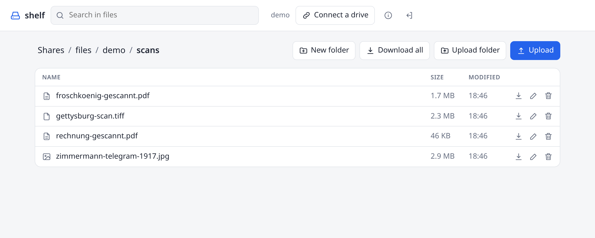
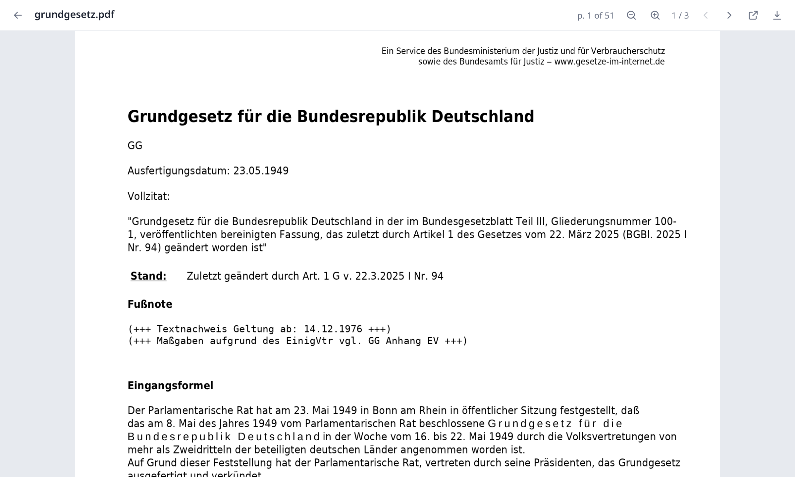
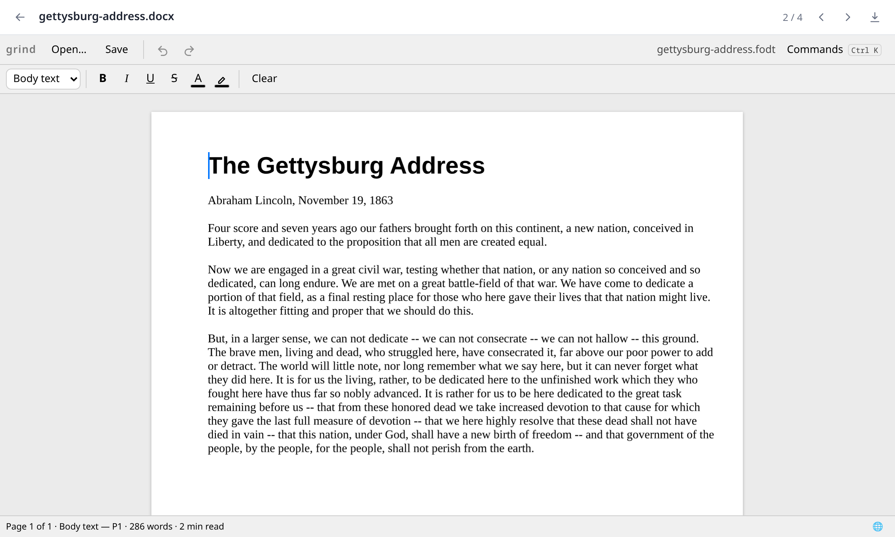
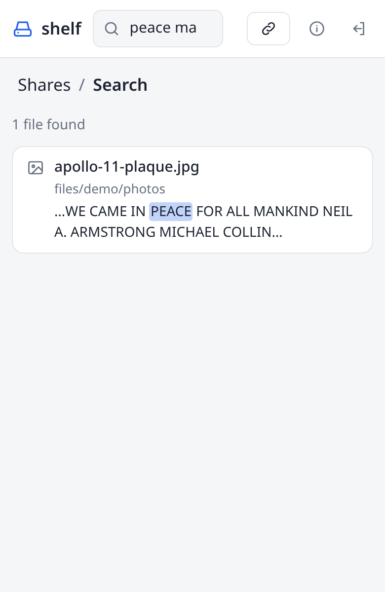

# shelf

**A home NAS that is easy to set up and understand.** shelf is one small
program with one config file. It stores files in ordinary directories, and
provides a web UI that works on phones and computers.


## What makes shelf different

- **Your files stay plain files.** A share is a directory. shelf does not
  import files or store them in a database. Stop shelf and your files remain
  available to backup tools, file managers, and other programs.
- **Find files by their contents.** Full-text search indexes PDFs, office
  documents, and text files. OCR adds text from scans and photos, so you can
  find an invoice by its customer number
  ([clerk](https://github.com/fwilhe2/clerk)).
- **Open files in the browser.** View photos, videos, music, PDFs, and text.
  Open spreadsheets and office documents with
  [grind](https://github.com/fwilhe2/grind), a browser-based office suite.
- **A network drive without a dedicated app.** Mount shares in Windows
  Explorer, macOS Finder, or Linux file managers using WebDAV.
- **Security controls by default.** Requests cannot escape a share through
  `..` paths or symlinks. Passwords are stored as bcrypt hashes. You can enable
  HTTPS with a private CA. The container runs rootless and has no shell.
- **Nothing leaves your home.** No cloud account, no telemetry; search and OCR
  run on the NAS itself.
- **Small enough to read.** A few thousand lines of Go and one HTML file.

Try shelf with demo files in a temporary container. The demo share, config, and
search index are kept in memory and discarded when the container stops. The
demo source files are cached under `~/.cache/shelf-demo-data`:
`test/demo.sh`, then open <http://localhost:18080/> (user `demo`, password
`demo`).

| | |
|---|---|
|  |  |
| Browse, upload folders, download folders as ZIP files, rename, and delete. | View photos, videos, and music. Move through a folder with the arrow keys or by swiping. |
|  |  |
| PDFs with a built-in [PDF.js](https://mozilla.github.io/pdf.js/). | Office documents (`.ods`, `.odt`, `.xlsx`, `.docx`, …) in grind. |



## What it does

- **Web UI**: browse, upload (including drag & drop of whole folders), download,
  download folders as zip, rename, delete, new folder. Works on phones too.
- **Viewer**: photos, videos, music, PDFs and text files open right in the
  browser. Flip through a folder with the arrow keys or by swiping.
- **Office documents**: open spreadsheets and text documents
  in the browser with grind. See [below](#office-documents).
- **Full-text search**: find files by the words in their name or
  text, with OCR for scans and photos. See [below](#search).
- **Network drive**: every share can be mounted via WebDAV.
- **Users and shares**: shares can be read-only and limited to some users.
- **One container image with everything**, rootless Podman, also on a
  Raspberry Pi. The plain binary runs without a container, too.

The screenshots use only demo files from `test/demo-data.sh`. Those files are
public domain or generated by the script. `test/browser/screenshots.js`
captures the screenshots.

<br clear="right">

## Install (Podman, rootless, e.g. Fedora Silverblue)

The `Containerfile` builds an image of about 120 MB. It includes shelf, PDF.js,
grind's web page for office documents, and clerk for full-text search and OCR.
The image uses the distroless `cc-debian13:nonroot` base, which has no shell or
package manager. The Quadlet unit runs the container rootless with a read-only
root file system, no capabilities, and `no-new-privileges`.

The container reads its config and files from **bind mounts** of host directories:
`~/.config/shelf` → `/config` and `~/nas-data` → `/data`. With
`UserNS=keep-id`, the container user is mapped to your own user, so the files on
the host belong to you and you can back them up, browse them or move them to
another disk like any other files. Edit the `Volume=` lines in
`deploy/shelf.container` to keep the data somewhere else, e.g. on a second disk
under `/var/mnt`.

```sh
podman build -t localhost/shelf:latest .
mkdir -p ~/.config/shelf ~/nas-data

# create the config and the first user
podman run --rm -it --userns keep-id:uid=65532,gid=65532 \
  -v ~/.config/shelf:/config:z -v ~/nas-data:/data:z \
  localhost/shelf init -data /data -listen :8443

# turn on HTTPS: list the names and IPs your devices use to reach the NAS
podman run --rm --userns keep-id:uid=65532,gid=65532 -v ~/.config/shelf:/config:z \
  localhost/shelf cert -hosts nas.local,192.168.1.20

# install and start the service
mkdir -p ~/.config/containers/systemd
cp deploy/shelf.container ~/.config/containers/systemd/
systemctl --user daemon-reload
systemctl --user start shelf
loginctl enable-linger $USER     # keep it running when you are logged out
journalctl --user -u shelf       # logs
```

Open `https://<your-nas>:8443/` and install the CA certificate on each device
that connects (see [HTTPS](#https)). Fedora Workstation and Silverblue's
default firewall zone allows ports above 1024. On other Fedora systems, open
port 8443 with `sudo firewall-cmd --permanent --add-port=8443/tcp` and
`sudo firewall-cmd --reload`.

Manage users and shares inside the running container. Changes apply without a
restart:

```sh
alias shelf='podman exec -it shelf /shelf'
shelf user add mom
shelf share add photos /data/photos
```

Share paths are interpreted inside the container, so the example share path
`/data/photos` refers to the mounted host directory. To share another host
directory, add a `Volume=` line to the unit first.

To update: pull the new source, run `podman build -t localhost/shelf:latest .`
again and then `podman auto-update` (or `systemctl --user restart shelf`).

Before you put your real files in, read [docs/real-data.md](docs/real-data.md):
how to import them, check the copy, and protect them against disk damage.

To run shelf on Kubernetes instead, with the image CI publishes as
`ghcr.io/fwilhe2/shelf`, see [deploy/kubernetes](deploy/kubernetes/README.md).

### Automatic backups

`deploy/shelf-backup` uses rsync to create a daily snapshot of `~/.config/shelf`
and `~/nas-data`. Each snapshot looks like a complete, browsable directory.
Unchanged files are hard-linked to the previous snapshot, so snapshots use
additional space only for changed files. To restore data, copy the files back.

```sh
install -D -m 755 deploy/shelf-backup ~/.local/bin/shelf-backup
cp deploy/shelf-backup.service deploy/shelf-backup.timer ~/.config/systemd/user/
echo 'BACKUP_DEST=/run/media/'$USER'/backupdisk/shelf' > ~/.config/shelf/backup.env
mkdir -p /run/media/$USER/backupdisk/shelf    # on the backup disk, once
systemctl --user daemon-reload
systemctl --user enable --now shelf-backup.timer
systemctl --user start shelf-backup           # first backup now
```

Create the destination directory before enabling backups. If the directory is
missing (for example, because the backup disk is not mounted), the backup
fails instead of writing to the system disk. By default, the script keeps the
last 14 snapshots; set `BACKUP_KEEP=` in `backup.env` to change this. Store
backups on a different disk, ideally one you can keep off-site.

## Without a container

shelf is a static binary and can run without a container. Office document
viewing and search are disabled until you configure their dependencies; see
[Office documents](#office-documents) and [Search](#search).

### Build

Requires Go 1.26 or newer.

```sh
go build -o shelf .

# for a Raspberry Pi 3/4/5 running a 64-bit OS:
GOOS=linux GOARCH=arm64 go build -o shelf .
```

### Quick start (just try it)

```sh
export SHELF_CONFIG=$PWD/shelf.json
./shelf init -data ~/nas-data      # asks for a user name and password
./shelf serve
```

Open the printed address (e.g. `http://192.168.1.20:8080/`) in a browser.

### Install as a service

```sh
sudo install -m 755 shelf /usr/local/bin/shelf
sudo useradd --system --home-dir /srv/shelf --shell /usr/sbin/nologin shelf
sudo mkdir -p /srv/shelf && sudo chown shelf:shelf /srv/shelf

sudo shelf init -data /srv/shelf
sudo chown shelf:shelf /etc/shelf/config.json

sudo install -m 644 shelf.service /etc/systemd/system/
sudo systemctl enable --now shelf
journalctl -u shelf            # shows the addresses it is reachable on
```

If you'd rather keep files owned by your own account, set `User=`/`Group=` in
`shelf.service` to your user and run `init` with `-data` pointing to a directory
you own. If share directories are under `/home`, remove `ProtectHome=read-only`.

## HTTPS

```sh
shelf cert                                   # on the host: names and IPs are detected
shelf cert -hosts nas.local,192.168.1.20     # or list them yourself (required in a container)
```

This creates a small private certificate authority (`ca.crt`, `ca.key` next to
the config file) and a server certificate signed by it, and turns on HTTPS in
the config. Restart shelf afterwards. No domain, no Let's Encrypt, no internet
access needed, and no reverse proxy: shelf does TLS itself.

**Each device has to trust the CA once.** Without that, browsers show a warning
and some clients (Windows Explorer in particular) refuse to connect at all.
Open `https://<your-nas>:8443/ca.crt`, accept the warning this one time, and
install the downloaded file:

| System | How |
|---|---|
| Fedora / Linux | `sudo trust anchor --store shelf-ca.crt` (Firefox: Settings → Certificates → Import) |
| Windows | double-click → *Install Certificate* → *Local Machine* → *Trusted Root Certification Authorities* |
| macOS | double-click → Keychain *System* → open the certificate → *Trust* → *Always Trust* |
| iOS / iPadOS | open the link in Safari → Settings → *Profile Downloaded* → install, then Settings → General → About → Certificate Trust Settings → turn it on |
| Android | Settings → Security → *Encryption & credentials* → *Install a certificate* → *CA certificate* |

After installation, the device trusts certificates signed by this CA. Install
the CA once per device. shelf renews its server certificate automatically
before it expires. Run `shelf cert -hosts ...` to add names or IP addresses;
this keeps the same CA.

The CA is name-constrained: it can only sign for private IP addresses,
`.local`, `.lan`, `.home.arpa`, `.internal` and the names given when it was
created. So even if `ca.key` leaks, it can't be used against other websites on
your devices. If you later need a name it doesn't cover, `shelf cert -new-ca`
creates a new CA, and every device has to trust the new one.

You can also use your own certificate: set `tls_cert` and `tls_key` in the
config.

## Managing users and shares

```sh
shelf user add mom                 # asks for a password
shelf user passwd mom
shelf user del mom
shelf user list

shelf share add photos /mnt/usb/photos                  # everyone, read-write
shelf share add movies /mnt/usb/movies -ro              # everyone, read-only
shelf share add taxes  /srv/shelf/taxes -users florian  # only florian
shelf share del photos                                  # files are kept
shelf share list
```

A running server picks up changes automatically, so you don't need to restart it.
Use `sudo` (or `-c FILE` / `SHELF_CONFIG`) when the config is in `/etc/shelf`.

## Office documents

shelf opens office documents in the browser using the web version of
[grind](https://github.com/fwilhe2/grind), an office suite that runs in
WebAssembly. Click an `.ods`, `.odt`, `.fods`, `.fodt`, `.xlsx`, or `.docx`
file in the file list to open it in shelf's viewer.

Documents open from the share but are **not saved back**. You can view and edit
them; *Save* downloads the edited copy in ODF format. Saving changes back to the
share is planned; see [docs/office.md](docs/office.md).

The container image includes grind's web page and enables office document
viewing. Without the container, build or obtain the grind web page (`ui_web/dist`
from grind commit 8bf5f12 or later). For example, create a container from
`ghcr.io/fwilhe2/grind-web` and copy `/usr/share/grind/web` from it. Set
`"office_dir"` in the config or `$SHELF_OFFICE_DIR` to that directory. Office
document viewing is disabled if neither is set.

## Search

The web UI search finds files by words in their names or contents, limited to
shares the user can access. It uses [clerk](https://github.com/fwilhe2/clerk)
to index PDFs, office documents, and text files. Tesseract OCR adds text from
scans and photos. shelf keeps the index current by itself: shortly after
files change through it, and every hour for files changed on the disk directly.
The *Search index* dialog (the button next to the search box) shows when each
share was last indexed and can start a run right away. The
container image includes the required components and enables search. Without
the container, install clerk and set
`"search": {"index": "/var/lib/shelf/clerk.sqlite"}` in the config or set
`$SHELF_SEARCH_INDEX`. See [docs/search.md](docs/search.md) for details.

To try search, `test/demo.sh` starts a temporary container with a share of demo
files: PDFs with and without text, scans, photos with text, and office
documents. The files are public domain or generated by `test/demo-data.sh`.
The share is kept in memory and discarded when the container stops. Open
<http://localhost:18080/> and sign in as `demo` with password `demo`.

## Viewing files

Click a file name to open it in a viewer above the file list, if the browser
supports that file type:

| Kind | Files |
|---|---|
| Pictures | `.jpg`, `.png`, `.gif`, `.webp`, `.avif`, `.svg`, … |
| Videos | `.mp4`, `.webm`, `.mov`, `.mkv`, … (whatever the browser can play: `.mkv` and `.mov` often only partly) |
| Music | `.mp3`, `.m4a`, `.ogg`, `.opus`, `.flac`, `.wav`, … |
| PDFs | `.pdf`, with PDF.js, so it works the same on every browser and on phones |
| Text | `.txt`, `.md`, `.csv`, `.json`, `.log`, source code, … (up to 5 MB) |
| Office documents | with grind, see [above](#office-documents) |

Other files open or download as usual. Press ← or →, or swipe on a phone, to
move to the previous or next file in the folder. Press Esc or use the browser's
Back button to close the viewer. You can bookmark the address of a viewed file
or open it in a new tab with a middle click.

## Connecting as a network drive

Use `http://<your-nas>:8080/dav/` as the WebDAV address. With HTTPS, use
`https://<your-nas>:8443/dav/`; Linux file managers that use URI schemes may
require `davs://` instead of `dav://`. Sign in with your shelf user name and
password. The web UI's **Connect a drive** button shows the address for your
setup.

| System | How |
|---|---|
| GNOME Files | *Other Locations* → *Connect to Server* → `dav://<your-nas>:8080/dav/` |
| KDE Dolphin | address bar: `webdav://<your-nas>:8080/dav/` |
| macOS | Finder → *Go* → *Connect to Server* (⌘K) → `http://<your-nas>:8080/dav/` |
| Windows | *This PC* → *Map network drive* → `http://<your-nas>:8080/dav/` |
| Linux, permanent mount | `davfs2` (`mount -t davfs http://<your-nas>:8080/dav/ /mnt/nas`) or `rclone mount` |
| Android / iOS | any file manager with WebDAV support |

**Windows over plain HTTP:** Windows blocks password authentication over
unencrypted HTTP by default. If you use HTTPS and have trusted the CA, skip
this step. Otherwise, run these commands in an administrator shell:

```
reg add HKLM\SYSTEM\CurrentControlSet\Services\WebClient\Parameters /v BasicAuthLevel /t REG_DWORD /d 2 /f
net stop webclient && net start webclient
```

Windows also limits WebDAV downloads to about 50 MB per file by default. You can
raise `FileSizeLimitInBytes` (same registry key, max `0xffffffff`), or use
[rclone](https://rclone.org) or the web UI for very large files.

## Configuration file

`/etc/shelf/config.json` (or `-c FILE`, or `$SHELF_CONFIG`):

```json
{
  "listen": ":8080",
  "users": [
    { "name": "florian", "password_hash": "$2a$10$..." }
  ],
  "shares": [
    { "name": "files",  "path": "/srv/shelf" },
    { "name": "movies", "path": "/mnt/usb/movies", "read_only": true },
    { "name": "taxes",  "path": "/srv/shelf-taxes", "users": ["florian"] }
  ]
}
```

To change `listen`, edit the file and restart the server. Optional:
`"tls_cert"` and `"tls_key"` (PEM file paths) turn on HTTPS, and `"tls_ca"` is
offered for download at `/ca.crt`. `shelf cert` sets all three. `"office_dir"`
turns on [office documents](#office-documents), `"search"` turns on
[search](#search).

## Security notes

shelf is intended for a trusted home network. Traffic uses unencrypted HTTP
unless you enable HTTPS with `shelf cert`. Do not expose shelf directly to the
internet. For remote access, use a VPN such as WireGuard or Tailscale.

## Layout of the code

| File | What |
|---|---|
| `main.go` | command line (`init`, `serve`, `user`, `share`, `cert`, `index`) |
| `config.go` | config file loading, validation, atomic saving |
| `server.go` | HTTP: login, JSON API for the UI, zip download, WebDAV |
| `office.go` | serves grind's web page for office documents under `/office/` |
| `search.go`, `indexer.go` | full-text search with clerk: `/api/search`, `shelf index`, and indexing by the server (`/api/index`) |
| `static.go` | serves the vendored third-party files (`web/vendor/`) and licence texts (`web/licenses/`) |
| `cert.go` | private CA, server certificates, automatic renewal |
| `fs.go` | the virtual file system: `/` lists shares, each share is an `os.Root` |
| `web/index.html` | the whole web UI, including the viewer, embedded into the binary |
| `web/vendor/` | third-party code the web UI loads (PDF.js), see [THIRD_PARTY.md](THIRD_PARTY.md) |
| `Containerfile`, `deploy/` | the container image, Quadlet unit, backup script and timer |
| `deploy/kubernetes/` | Kubernetes manifests (Kustomize) for the same image |
| `deploy/third-party.sh` | collects the image's Debian packages and clerk's crates with their licences, and checks them against THIRD_PARTY.md |
| `test/e2e.sh` | end-to-end test and demo of the container (run by CI, see below) |
| `test/browser/` | browser tests of the web UI in Chromium and Firefox (run by CI) |
| `test/demo.sh`, `test/demo-data.sh` | a throwaway container with demo files |

## Tests

Run `go test ./...` to run the unit tests. `test/e2e.sh` uses an image you build
first with `podman build -t localhost/shelf:latest .`. It starts the image with
the settings from `deploy/shelf.container`, configures HTTPS, two users, and
three shares, then exercises uploads, downloads, renames, deletes, and search
over the web API and WebDAV. It also checks file contents and access rules from
the host, verifies data survives a restart, and runs the backup script.

The Playwright tests in `test/browser/` exercise the web UI in Chromium and
Firefox, including each file viewer and office documents in grind. See
[test/browser/README.md](test/browser/README.md). CI runs all three test suites
on every push; the end-to-end test report appears in the job summary.

## License

shelf is licensed under the GNU Affero General Public License v3.0 or later, see
[LICENSE](LICENSE). It includes components by others under their own
(permissive) licences, listed in [THIRD_PARTY.md](THIRD_PARTY.md) and in the web
UI's *About* dialog.
